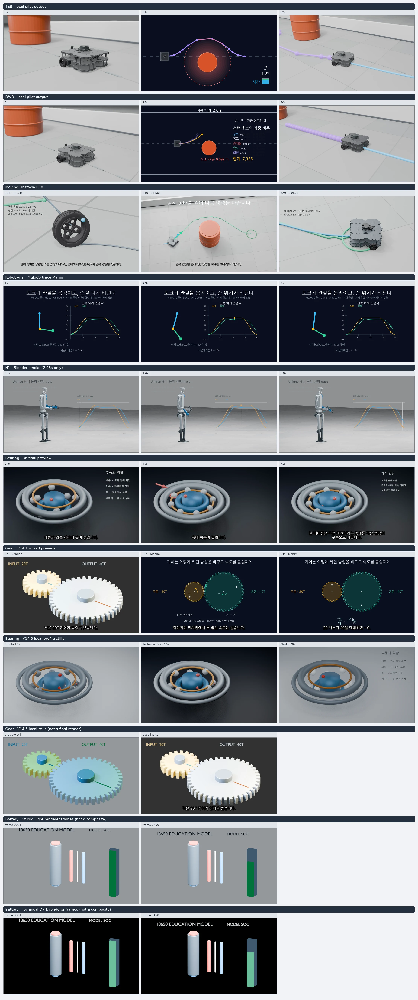
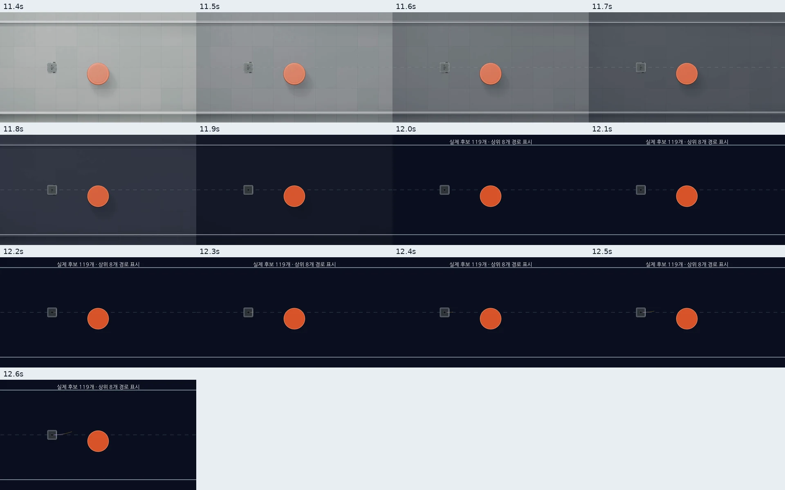
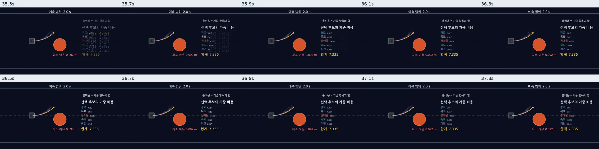

# Cross-Pilot Visual QA

## Scope and decision

- Audit branch: `audit/cross-pilot-visual-consistency`
- Audited source HEAD: `331bdfea6625b6cef5fa90f64f77e3702db40c03`
- `origin/main` at check: `d387bc1ea8bc23c447b0d3572c1951a2cbfa3b03`.
- PR #10 at check: open / Draft, head `331bdfea6625b6cef5fa90f64f77e3702db40c03`, base `main` at `d387bc1`, mergeable. This worktree is separate and does not modify PR #10 or `main`.
- Audit branch at start: `ccd0706e1d64cb6dcd29e657c20987e3f9af997b`, synced with its remote tracking branch.
- Review method: existing MP4s and their recorded reports, sampled frames, four published evidence sheets, shared visual-system source inspection, and one current-source PyBaMM-backed Blender still render.
- No existing full video was re-rendered. The generated render is one frame used to resolve a suspected title-margin defect.

**Overall Visual Quality: 7.4/10 (subjective snapshot audit).** This is the equal-weight arithmetic mean of Visual Consistency (7.5), Typography (7.0), Layout (7.5), Color/Lighting (8.0), and Educational Communication (7.0). It reflects visible design quality in the inspected output frames. It is not a motion-quality or educational-effectiveness score.

**Overall Evidence Confidence: MEDIUM.** Output hashes and real frames were checked, and some current renders have detailed provenance. Several historical TEB/DWB/Robot Arm/Gear outputs cannot be bound to exact source/input hashes. The two Battery preview hashes have strong technical reports and a recorded human-acceptance entry, but the latest integrated QA commit contains a contradictory `INCOMPLETE` row for those same files. DWB was inspected as extracted frames, not perceptually reviewed at continuous 1× playback. These limits reduce confidence in the conclusions, not the visible design score.

| Dimension | Score | Evidence-based assessment |
|---|---:|---|
| Visual consistency | 7.5/10 | Semantic colors and two visual profiles are shared by current education renderers; older robotics pilots predate or do not record the same source contract. |
| Typography | 7/10 | Main headings and Korean captions are legible in sampled frames. Small numeric annotations in dense technical scenes need full-resolution, normal-speed review; contact-sheet scaling is not sufficient for a readability PASS. |
| Layout | 7.5/10 | Physical subjects generally have useful separation. DWB handoff samples show a brief loss of path context, and some technical frames are dense. |
| Color / lighting | 8/10 | Light physical scenes and dark analytical scenes serve different purposes; model silhouettes and orange obstacle/input accents remain distinct. Do not force one background across renderers. |
| Educational communication | 7/10 | Several samples connect a physical object to its analytical representation. Still samples cannot establish that the complete explanation is understandable. |
| Motion QA | INCOMPLETE | This audit sampled frames, not complete normal-speed playback. Moving Obstacle's prior review also marks full motion/audio review incomplete. |

No P0/P1 current-source issue was established. No source-level visual edit met the evidence threshold in this pass. The DWB handoff artifact shows a route gap, but its source provenance is unknown; the cost-panel overlap was not reproduced on the recorded video hash.

### Evidence confidence by claim

| Claim | Confidence | Basis / limit |
|---|---|---|
| Visual quality score | MEDIUM | Real output frames and exact local output hashes were inspected; multiple legacy files do not identify the source commit that produced them. |
| DWB handoff observation | HIGH for the archived MP4; LOW for current-source relevance | MP4 SHA matched the recorded value and its full decode passed. The render source/input hashes are absent; this is an observation of that file, not current code. |
| DWB cost-panel no-overlap observation | MEDIUM | Ten time-labeled frames from the same hash show no overlapping candidate rows; native full-resolution stills are clear, but no continuous playback was reviewed. |
| Battery technical validation | HIGH as a recorded result; raw MP4 recheck unavailable | The integration QA record binds exact video hashes to solver, asset, sparse plan, renderer versions, frame count, full decode, and CI. The two MP4s are no longer present at the recorded `/tmp` paths, so their bytes could not be re-hashed in this audit. |
| Battery prior human acceptance | CONFLICTING RECORDS | Commit `c636062` records user 1× acceptance for both exact MP4 hashes; later commit `cfe741e` repeats those hashes but also marks full 1× review `INCOMPLETE`. The latest source document contains both statements. The audit preserves the historical PASS entry but uses `INCOMPLETE` as the reconciled status until the record is clarified. |
| Learner comprehension | NOT REVIEWED | No learner study or comprehension feedback was present in the reviewed evidence. |

## Contact sheets and audit artifacts

The originals are local under `/tmp`; compact WebP copies are committed with this report for remote review. They use actual project output frames only. Every WebP is below 1 MB. Section labels distinguish historical videos, V14.5 current-source local stills, renderer layers, and non-final/smoke outputs.

| Artifact | Contents | SHA-256 |
|---|---|---|
| [`cross_pilot_contact_sheet.webp`](evidence/cross_pilot_contact_sheet.webp) | All audited pilots and clearly labeled historical/current/local-still/smoke rows. 2220×5305; 454,324 bytes. Original PNG SHA-256 `23db302c4507c3bf1ae65346b8a5473d0c5d06728de6e63e6fefddbf4259e358`; WebP SHA-256 `f13a242a9f37161095019065748423652bdd04ce5883ae4551f31ac6b9c0873a`. | `f13a242a9f37161095019065748423652bdd04ce5883ae4551f31ac6b9c0873a` |
| [`renderer_transition_contact_sheet.webp`](evidence/renderer_transition_contact_sheet.webp) | TEB/DWB at 11.4/12.0/12.6 s and Gear V14.1 at 33.5/34.0/34.6 s. 2220×1473; 80,206 bytes. Original PNG SHA-256 `6306bf4a80bbd295ff850ec755ed12054a38e821d4fa8a6caf7f83c1ad42a9e2`; WebP SHA-256 `f0e0d01902fe5c15a39e4f37b0d7f8f0b6536e1e514e521343144526d3f5339c`. | `f0e0d01902fe5c15a39e4f37b0d7f8f0b6536e1e514e521343144526d3f5339c` |
| [`dwb_handoff_sequence.webp`](evidence/dwb_handoff_sequence.webp) | 13 source frames sampled at 10 fps from 11.4–12.6 s, labeled by time. 1920×1200; 41,790 bytes. PNG source SHA-256 `e5ea4dbdb1319173ad7abe8fb11464f5aefc9b512d17ea42cbd52b41b6308eaa`; WebP SHA-256 `a6e85d7f9911c06eb713f6201b5612b4ee4b081e17747d7faf91acf47edb5189`. | `a6e85d7f9911c06eb713f6201b5612b4ee4b081e17747d7faf91acf47edb5189` |
| [`dwb_cost_panel_sequence.webp`](evidence/dwb_cost_panel_sequence.webp) | Ten source frames sampled at 5 fps from 35.5–37.3 s. 2400×600; 87,314 bytes. PNG source SHA-256 `90132782139474dbd627a3a7ef55bbbd2ff50284a9242e05e4b67932e42bd6c0`; WebP SHA-256 `06341572be9b790f917940b472ea266d8aa2a0cd2c56162441eac4ead4f55628`. | `06341572be9b790f917940b472ea266d8aa2a0cd2c56162441eac4ead4f55628` |
| `/tmp/make_simulation-visual-audit/battery_render/source-frame-1/battery_still.png` | One 960×540 current-source Blender frame, generated from a validated PyBaMM result to inspect the title margin. | `9735e44698f164253372cee3013f90e598b07c7acadae5b66bf7a75c3b5ee548` |

The full contact sheet labels V14.5 battery stills as non-composite frames and V14.5 gear stills as non-final output; the H1 file is labeled as a 2.03 s smoke. They must not be interpreted as completed final videos. The original transition sheet and two focused DWB sheets were visually compared to their WebP copies; headings, time labels, and sampled content remain legible. The DWB short clip is `/tmp/make_simulation-visual-audit/dwb-finalization/dwb_handoff_10.5-13.5.mp4` (3 s, 1920×1080, 30 fps, H.264 + AAC, 90 frames, SHA-256 `5d7656d8c7e11a6b587e69cd226fcfa15b82ddcb7bed10241e634ad307c5170f`). It is a convenience excerpt of the original MP4, not a new render; subtitle metadata was not carried into the excerpt.

### Cross-pilot frames

### DWB handoff at 10 fps

### DWB cost panel at 5 fps

## Shared design system: guidance versus adoption

The current V14.5 system defines semantic colors, `studio_light` and `technical_dark` profiles, typography/layout values, and motion ranges in `core/visual_primitives/design_tokens.json` and its Python loader. The Manim kit imports the token module and exposes theme, palette, and semantic text helpers. The Blender scene kit builds semantic materials from shared tokens; `studio_utils.py` applies the selected world profile. Current Battery and Gear education scenes call those helpers.

That is real but partial adoption. TEB/DWB and older pilot outputs remain their own established visual programs; the audit found no basis to migrate them wholesale to V14.5 tokens. Shared meaning (input/output/obstacle/trajectory) is more consistent than identical backgrounds or identical layouts. Preserve that distinction.

## Content review

| Content | Information | Layout | Typography | Color | Consistency / provenance | Motion QA |
|---|---|---|---|---|---|---|
| TEB | 7.5/10 — robot, obstacle, path, and analytical frame are identifiable in sampled views. | 7/10 — subject separation is good; explanatory frame is denser. | 7/10 — main labels readable in samples; small annotations not assessed at native playback size. | 8/10 — orange obstacle and purple/cyan path remain distinct across the sampled renderer handoff. | 6/10 — historical local MP4 has no embedded renderer/source/input provenance. | INCOMPLETE; sampled 0, 31, 62 s and 11.4/12.0/12.6 s handoff only. |
| DWB | 7/10 — candidate path and cost ranking can be identified; path context drops during the sampled renderer cut. | 6.5/10 — robot pose is stable in the samples, but route is absent for about 0.8 s. | 7/10 — no cost-row overlap was visible in the 35.5–37.3 s sequence; the values are compact. | 8/10 — obstacle and path colors remain clear. | 5.5/10 — MP4 SHA is verified but source/render-input provenance is absent; it is a historical artifact. Current B04 source segment renders cleanly. | STALE_ARTIFACT for current-source conclusions; normal-speed motion review INCOMPLETE. |
| Moving Obstacle R18 | 8/10 — the obstacle/robot/path relationship is clear in the sampled beats. | 7.5/10 — physical and explanatory layouts are appropriately distinct. | 6.5/10 — sampled overlays are small at contact-sheet scale; full-resolution reading not certified here. | 8/10 — green planned path, cyan/blue reference, and orange obstacle are distinct. | 7/10 — output has trace/pose validation and a review record, but no complete renderer-source binding was found. | INCOMPLETE; report records mosaic review of 90 frames, not complete continuous playback/audio. |
| Robot Arm Manim | 7/10 — arm pose and target/actual graph coexist, but the complete lesson is a short historical clip. | 7/10 — arm and plot have separate regions. | 6.5/10 — graph ticks are small in the sampled video. | 7.5/10 — target/actual curves and joint colors are distinguishable. | 5.5/10 — historical output lacks source/input provenance. H1 Blender file is a separate 2.03 s smoke, not a final. | INCOMPLETE; sampled 1, 4.9, 8 s / H1 0.1, 1.0, 1.9 s. |
| Bearing R6 | 8.5/10 — components and rolling elements are visually prominent; the object reads clearly. | 8/10 — clean 3D composition with supporting text separated to the side. | 7/10 — labels are readable in sampled frames, but small text at 540p warrants full-speed review. | 8/10 — metal races, balls, and cage are visually separable. | 7/10 — validated 84 s silent preview and asset provenance exist; exact source commit/render-code hash is not in the report. This is pre-V14.5. | INCOMPLETE in this audit. The prior user review was PASS for R6 at normal speed, but it does not validate the later V14.5 sources. |
| Gear V14.1 | 7.5/10 — input/output ratio and counter-rotation are shown. | 7/10 — gear pair dominates the physical frame; the analytical screen has several concurrent labels. | 6.5/10 — equation labels are small in 540p samples. | 8/10 — input/output use distinct semantic colors. | 6.5/10 — 80 s pre-V14.5 mixed preview exists; no exact source binding established in this audit. | INCOMPLETE; samples at 5, 39, 64 s and around 33.5–34.6 s only. |
| Battery V14.5 | 7/10 — cell, electrodes, SOC gauge, and computation layers have clear roles in stills/layers. | 7/10 — current-source still has safe title margin; prior mixed composition was technically validated. | 7/10 — current-source title is not clipped; detailed graph tick readability remains unreviewed in this audit. | 8/10 — light/dark profile separation is effective and cell/electrode colors are distinct. | 7.5/10 — two mixed previews have detailed technical provenance records; the video files are no longer at their recorded `/tmp` paths. | Prior human review is recorded for exact hashes but contradicted by the later same-report `INCOMPLETE` row; see Battery evidence below. |

Scores are subjective assessments of the sampled visual evidence, not a metric produced by an automated checker. `INCOMPLETE` means motion has not been established by this frame-based audit.

## Observations and priorities

### DWB cost panel — NOT REPRODUCED on the recorded artifact

- **Scene / time:** DWB MP4 SHA `8314f6b2280d689cf4a63753b4f056d335bedab64bad2cff02cdf33a1477c961`, 35.5–37.3 s.
- **Observed:** ten frames sampled at 5 fps show the cost rows and total `7.335`; the candidate command rows do not overlap the cost panel in those samples. The prior overlap concern is **CLOSED / NOT REPRODUCED for this output hash**.
- **Source check:** current tracked `pilots/02_dwb_reference/manim_shot.py` SHA-256 is `86a10e066641329b2e78850191d78270a1c89194327ceb69e529a3685873e4b2`; B04 fades the command rows before the cost panel. A current-source 1080p30 render of B04 produced the same tested frame before and after a temporary explicit removal (`mean pixel difference 0`, frame SHA identical). The temporary edit was reverted.
- **Artifact integrity:** source MP4 hash matches the recorded SHA; metadata is H.264 1920×1080 at 30 fps, 2500 frames / 83.333 s, with AAC audio and mov_text subtitles. FFmpeg full decode exited successfully.
- **Disposition / status:** no code change. Current B04 source also contains the intended fade-out. The old MP4 remains source-unbound, so this result is artifact-specific rather than proof of source-to-video reproducibility.

### DWB handoff — STALE_ARTIFACT; current-source status unresolved

- **File / integrity:** `/home/sang/make_simulation/pilots/02_dwb_reference/output/dwb_reference_ko.mp4`; SHA-256 exactly matches `8314f6b2280d689cf4a63753b4f056d335bedab64bad2cff02cdf33a1477c961`. Metadata is H.264 1920×1080, 30 fps, 2500 frames, 83.333 s; full FFmpeg decode passed. Subtitles are present as mov_text. No MP4 sidecar binds it to the current render sources or trace hashes.
- **Samples:** 13 frames at 10 fps from 11.4–12.6 s are in `evidence/dwb_handoff_sequence.webp`; the source frames cover the actual clip at 0.1 s steps.
- **Observed sequence:** Studio Light route remains visible through 11.7 s. The Technical Dark cut begins by 11.8 s; robot and obstacle remain in stable positions, while the route is absent through 12.5 s. A thin yellow candidate curve appears at 12.6 s. Thus the old output has an observed route-context gap of about 0.8 s and the route's visual representation/color changes. The new candidate is not clearly identifiable as the same route from these still samples alone.
- **Continuous review:** the original 10.5–13.5 s section was launched through `ffplay` at 1× outside the sandbox, and playback returned successfully. The agent has no live view of the player window/audio, so naturalness and perception cannot be independently judged; normal-speed perceptual review is **INCOMPLETE**, not PASS. The output classification for current-source conclusions is **STALE_ARTIFACT** because source/input provenance is missing.
- **Disposition:** no code change. Do not treat the old clip as evidence of a current-source defect. For a current-source judgment, render only this handoff from the current manifest/trace with source hashes, then inspect a continuous 1× clip. If route loss is reproduced, propose a separate minimal fix.
- **Status:** historical artifact symptom observed; current source `NOT REVIEWED` at continuous speed.

### Battery title margin: suspected issue not reproduced

The older local frame raised a clipping concern. A new single-frame render from current HEAD shows the full `18650 EDUCATION MODEL` heading with visible top margin in 960×540. No title-position fix is warranted. This is not a full Battery video review.

### Battery Mixed Preview: technical evidence and human-review record

The separate integration QA worktree is at `cfe741e6a341b701d934d34ee2a8a3e82e56cc74` (2026-10-15 23:51:59 +09:00). Its report is [V14_3_V14_5_INTEGRATION_QA.md](https://github.com/hinoonyaso/make_simulation/blob/integration/v14.3-v14.5-validation/docs/integration/V14_3_V14_5_INTEGRATION_QA.md). That record and the PR #10 description bind these Technical Dark / Studio Light previews to source HEAD `331bdfea6625b6cef5fa90f64f77e3702db40c03`:

| Evidence | Technical Dark | Studio Light |
|---|---|---|
| Recorded output SHA-256 | `669b20b6e2d76eba936241d28f47ca595493e681b661f97ac8e122b7a1359fb8` | `d42259957911d06be8f01d996b14cc4ac886668e156438bae6005a07ea9f25d2` |
| Recorded format | 960×540, 30 fps, H.264, 720 frames, 24 s; silent by design | Same |
| Recorded render provenance | Blender 5.2.1, Manim 0.21.0, sparse 1 still + 180 animation frames, same validated PyBaMM result | Same |
| Shared solver result | PyBaMM 26.10.0.0 / IDAKLUSolver; 361 samples / 1800 s; SHA-256 `e29e858dd80f48c969f8d4b51f6ef004c62241175f598c5b7bd965b65fb44b25` | Same validated result |
| Production/media validation | PASS in recorded QA: manifest/timeline/caption timing and H.264 full decode | PASS in recorded QA |
| Remote Actions on HEAD 331bdfea | [Education Renderer #65 PASS](https://github.com/hinoonyaso/make_simulation/actions/runs/38754717908); [PyBaMM Battery #32 PASS](https://github.com/hinoonyaso/make_simulation/actions/runs/38754718561); [AI Trace #144 PASS](https://github.com/hinoonyaso/make_simulation/actions/runs/38754717889) | Same run results; these checks validate the PR head, not profile-specific renders |

The QA report records prior user 1× acceptance for both exact hashes in its `c636062` release-gate section. The later `cfe741e` final section repeats those hashes but marks full 1× review `INCOMPLETE`, saying only transition samples were inspected. Git blame dates the PASS record to 23:00:41 and the later INCOMPLETE row to 23:51:59 on 2026-10-15; both concern source head `331bdfea` and the same output hashes. The newer row is used as the reconciled status, while the earlier approval record is preserved as historical evidence. The two MP4s no longer exist at their recorded `/tmp/pr10-main-merge-qa/renders/...` paths, so their bytes could not be re-hashed or re-watched here. Technical validation remains PASS as recorded; the latest integrated QA status for human review is INCOMPLETE; learner comprehension remains untested.

## Reproduction and provenance

### Existing videos

| Content | Local file | Output SHA-256 | Format / samples | Source provenance |
|---|---|---|---|---|
| TEB | `/home/sang/make_simulation/pilots/01_teb_reference/output/pilot_teb_reference.mp4` | `2ae70645da50bd48c0155de69f02d0222816c86a5174a46c60b55216f555b615` | 1920×1080, 30 fps, 71.2 s; 0, 11.4, 12, 12.6, 31, 62 s | Legacy ignored output; exact renderer commit, settings, and trace hash not bound to video. Current `manim_shot.py` SHA-256 `67b54edde80f4650fd7a2b0d4488a25731fbcc0d7d65525aba8366677d3eab8f`. |
| DWB | `/home/sang/make_simulation/pilots/02_dwb_reference/output/dwb_reference_ko.mp4` | `8314f6b2280d689cf4a63753b4f056d335bedab64bad2cff02cdf33a1477c961` | 1920×1080, 30 fps, 83.333 s; 0, 11.4, 12, 12.6, 36, 70 s | Legacy ignored output; exact renderer commit/settings/input hashes not bound. Current `manim_shot.py` SHA-256 `86a10e066641329b2e78850191d78270a1c89194327ceb69e529a3685873e4b2`. |
| Moving Obstacle R18 | `/home/sang/make_simulation/pilots/05_moving_obstacle/revision_18/output/planner_control_long_ko_v18.mp4` | `09e8fa56d496fe4980af70a5277bccad5fd0ff39acfb79ec24fc2723db42b095` | 1920×1080, 30 fps, 382.4 s; B08 123.44, B19 333.63, B20 356.20 s | `render_validation.json` and `render_review.json` were present and report trace/pose validation; 90 mosaic frames reviewed. Exact source-tree hash was not linked to the MP4. |
| Robot Arm | `/home/sang/make_simulation/pilots/v10_mujoco_arm/output/mujoco_h1_arm.mp4` | `5bc8d3592d6eed6225e423b02a5a98a037122b6bea397b6d2dd4bd29c04afe58` | 1920×1080, 30 fps, 9.8 s; 1, 4.9, 8 s | Historical output, no renderer/input provenance found. Scene SHA-256 `35f040718ed93e4275b076750cd291d9cb81ba3eaca8b60b727f7232f3e4a4f7`; builder SHA-256 `162043d4508b7a6871edc3c616d122697ead8b50283982f41402f112ff57e5ec`. These hashes identify current files only, not the video's origin. |
| H1 Blender smoke | `/home/sang/make_simulation/pilots/v11_2_h1_blender/output/h1_trace_blender.mp4` | `c057af1ef7c9dfcd706a503e384d62d11d91da772aae76d24771ebe2c8e7be6b` | 1920×1080, 30 fps, 2.033 s; 0.1, 1.0, 1.9 s | Smoke artifact only; not a lesson/final video. |
| Bearing R6 | `/home/sang/make_simulation-r6/pilots/v13_education/output/r6_visual_qa/r6-final/preview.mp4` | `c44219f83365482ef12e0223994b59c0022ff849a83e8c59655d9480109bd457` | 960×540, 30 fps, 84 s; 24, 49, 71 s | `SILENT_PREVIEW`; H.264/full decode PASS; Blender 5.2.1 / Manim 0.21; asset hash recorded. Exact renderer source commit/hash not recorded; pre-V14.5. |
| Gear V14.1 | `/home/sang/make_simulation/pilots/v14_education/output/gear-v14.1-final-fixed/preview.mp4` | `559c54ced14f973614ba6ef529446d5f8e79ca177c62509b76ec846311390cad` | 960×540, 30 fps, 80 s; 5, 33.5, 34, 34.6, 39, 64 s | Historical pre-V14.5 mixed preview; exact source/input binding not established here. |

### Current-source Battery still

| Item | Value |
|---|---|
| Source HEAD | `331bdfea6625b6cef5fa90f64f77e3702db40c03` |
| Scene source | `pilots/v14_education/blender/battery_scene.py`, SHA-256 `9b00ff4651fa42408bc28b02db81656576ef8c1ae0fa809e5bbd24ff7ee3c3a2` |
| Solver | PyBaMM 26.10.0.0, IDAKLUSolver, CPU, SPM/Chen2020, 1C, 1800 s; 361 samples at 5 s; result SHA-256 `e29e858dd80f48c969f8d4b51f6ef004c62241175f598c5b7bd965b65fb44b25` |
| Render | Blender 5.2.1 LTS, 960×540, 30 fps, `technical_dark`, still frame 1; renderer asset validation PASS |
| Image | `/tmp/make_simulation-visual-audit/battery_render/source-frame-1/battery_still.png`; SHA-256 `9735e44698f164253372cee3013f90e598b07c7acadae5b66bf7a75c3b5ee548` |
| Limits | One still validates title placement only. It does not validate the mixed Battery sequence, graph labels, animation, audio, or 1080p final. |

## Shared design decisions and next improvements

### Keep

- Continue using the two existing profiles for distinct jobs: studio-light physical scenes and technical-dark analysis. They already provide useful visual contrast across a lesson.
- Preserve semantic colors for input/output, obstacles, candidate paths, and axes. Meaning should follow the object/data when the renderer changes.
- Keep physical models uncluttered. Add explanatory overlays only where they explain a real state or calculation.

### Improve next

1. **Bind every deliverable video to its renderer/source/input hashes.** This is the highest-leverage cross-pilot improvement: it would distinguish current-source defects from stale ignored outputs and make frame comparisons repeatable.
2. **Review renderer handoffs as continuous clips.** In particular, inspect DWB route continuity at 11.4–12.6 s on a provenance-bound render before changing timing or reveal choreography.
3. **Review dense technical labels at native output size.** Use the 1080p source frame and 1× playback; do not infer readability from the resized contact sheet.

No global token change is justified by this audit. A scoped visual edit should follow only after a same-source output confirms a concrete defect.

## Changed files and validation

- Changed files: this report and four compact evidence WebPs. No scene, shared kit, design token, trace, timeline, or existing media was edited.
- Solver validation/render: current PyBaMM battery solver returned PASS with 361 samples and full requested duration; one current-source Blender still rendered and its asset validation passed.
- DWB diagnostic: original video hash and metadata verified; full decode passed; 3 s excerpt made and launched in ffplay at 1×; 13 transition frames and 10 cost-panel frames inspected. Current source B04 had also rendered at 1920×1080/30; its cost-panel frame remained pixel-identical with and without the temporary explicit removal (`mean pixel difference = 0`). The no-op source edit was reverted.
- Contact sheets: original PNGs inspected, WebP copies checked visually and by dimensions/hash; all four are under 1 MB. The original DWB excerpt remains local under `/tmp`, not committed.
- Full suite, all-scene style check, complete video decode, 1080p final render, and audio review were not repeated because no source changed and this is a comparative audit. Do not treat them as PASS for this work.
- `git diff --check`: run before commit.

## Final QA status

- P0/P1 current-source visual blocker: none established from reviewed frames.
- Confirmed current-source title clipping: none; the suspected Battery issue did not reproduce.
- DWB cost panel: **CLOSED / NOT REPRODUCED** on output hash `8314f6b...`; current B04 source has the intended fade.
- DWB handoff: **STALE_ARTIFACT** symptom observed (route absent about 0.8 s) and **INCOMPLETE** for current-source/continuous perceptual review.
- Battery production/technical validation: **PASS as recorded** for both exact preview hashes, plus three CI checks on HEAD `331bdfea`.
- Battery prior human acceptance: **recorded PASS, then contradicted by a later INCOMPLETE row**; reconciled latest status is **INCOMPLETE** because the files are unavailable to resolve it here.
- Audio/caption sync, full-speed review of all pilots, current-source DWB motion acceptance, and learner comprehension: **INCOMPLETE / NOT REVIEWED**.
- Current overall Visual Quality: **7.4/10 snapshot audit**. Overall Evidence Confidence: **MEDIUM**. This is not a production-wide final visual acceptance.
